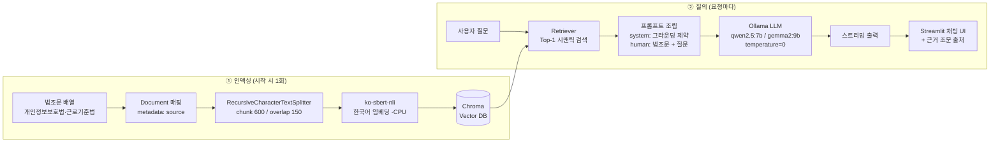

# Architecture — 로컬 법률 RAG 시스템

## 1. 설계 목표

| 목표 | 설계 결정 |
|---|---|
| **100% 온프레미스 보안** | 모든 추론·임베딩·벡터 검색이 로컬 머신 내부에서 수행. 질문·법령 데이터가 외부로 전송되지 않음 |
| **저사양(CPU 전용 16GB RAM)** | 9B 이하 SLM(소형 언어 모델), CPU 동작 가능한 경량 임베딩(`ko-sbert-nli`), 인메모리 Chroma |
| **한국어 품질** | 한국어 특화 임베딩 + 한국어 지시 이행 능력이 검증된 모델(Qwen2.5/Gemma2) 채택 |
| **환각(Hallucination) 억제** | 엄격 그라운딩 프롬프트 + 조문 경계를 보존하는 청킹 전략 |

## 2. 전체 파이프라인



## 3. 구성 요소

### 3.1 추론 엔진 — Ollama LLM

- Ollama 로컬 서버를 OpenAI 호환 API 형태로 상주시켜 사용 (LangChain `Ollama` / `OllamaLLM` 래퍼).
- 모델 실험 이력:
  - `deepseek-r1:1.5b` — 초경량이나 한국어 답변 품질 부족 → **제외 (주석으로 흔적 남김)**
  - `gemma2:9b` — 노트북 실험 기본. 한국어 지시 이행 우수
  - `qwen2.5:7b` — Streamlit 앱 기본. 중국어 잔여 출력 없이 한국어로 정착
- `temperature=0`: 법률 QA 특성상 창의성을 배제하고 결정론적 근거 회수가 우선.

### 3.2 임베딩 — `jhgan/ko-sbert-nli`

- 한국어 SBERT 계열 임베딩으로, 리소스 대비 문맥 이해도가 높아 CPU 환경에 적합.
- `device='cpu'`를 명시하여 GPU 부재 환경에서도 결정적이게 동작.
- 최초 1회 HuggingFace Hub에서 다운로드 후 로컬 캐시 사용.

### 3.3 벡터 스토어 — Chroma

- 별도 서버 프로세스 없이 임베디드 모드로 실행 (`Chroma.from_documents`).
- 코사인/유클리드 거리 기반 시맨틱 검색, 현재 `k=1`(가장 유사한 조항 1개)로 Top-K 제한.
- 근거 조문이 과다 주입되어 소형 LLM 컨텍스트가 흐려지는 것을 방지하는 목적의 보수적 설정.

### 3.4 청킹 전략 — `RecursiveCharacterTextSplitter`

법조문의 구조적 특성("조-항-호")을 보존하는 것이 핵심 설계 포인트입니다.

| 파라미터 | 값 | 근거 |
|---|---|---|
| `chunk_size` | 600 | 조문 1개(제15조 등 항·호 포함)가 통째로 들어가는 크기 |
| `chunk_overlap` | 150 | 경계에서 항 번호(②), 호 번호(1.)가 잘려 버려 컨텍스트가 붕괴되는 것을 방지 |

- 침범 없이 잘린 조문은 "제1항제1호에 따른…", "② …" 같은 조각이 되고, 이는 LLM에게 근거 없는 규범처럼 읽혀 환각을 유발함 → overlap으로 완화.
- 청크 단위 메타데이터에 `source: 대한민국 법령집`을 부여하여 출처 추적 가능.

### 3.5 프롬프트 설계 — 엄격 그라운딩 (Grounding)

```
system: 당신은 대한민국의 법령 문서를 기반으로 답변하는 전문 법률 어시스턴트입니다.
        반드시 [참고 법조문]의 내용만을 엄격한 근거로 삼아 답변하세요.
        문서에 없는 내용은 절대 상상해서 답변하지 마세요.        ← (Streamlit 앱: 추가로 "영어/중국어 답변 금지")
human:  [참고 법조문]\n{context}\n\n사용자 질문: {question}\n\n답변:
```

- **근거 이외 금지**: 검색된 조문만 유일한 근거로 바인딩하여 법률 도메인의 환각 리스크를 최소화.
- **언어 고정**: 소형 모델의 code-switching(답변 도중 영어·중국어 전환) 문제를 시스템 프롬프트로 억제.
- 검색 결과를 포맷팅해 모델에 주입하는 수동 오케스트레이션 방식 (LCEL 체인 대신 명시적 단계 구성 → 디버깅 용이).

## 4. 데이터 흐름 상세

### 인덱싱 (앱 시작 시 1회 실행)

1. 법조문 문자열 배열 → `Document(page_content, metadata={"source": …})`
2. `split_documents()` → 조문 보존형 청크 리스트
3. `ko-sbert-nli`로 임베딩 → Chroma 컬렉션 생성

### 질의 (사용자 입력마다)

1. **Streamlit**이 채팅 입력을 받아 세션 상태(`st.session_state.messages`)에 기록
2. 질문 문자열을 임베딩 → Chroma에서 **Top-1 조문** 회수
3. 시스템 프롬프트 + `{context}` + 질문으로 메시지 구성
4. Ollama에 요청, 생성 토큰을 **스트리밍**으로 받아 UI에 실시간 표시 (커서 `▌`)
5. 생성 완료 후 답변 하단에 **근거 조문 출처**(`retrieved_docs[0].page_content[:40]`)를 붙여 근거 축소(Attribution) 제공

## 5. 신뢰성·보안 고려사항

| 항목 | 현재 처리 | 향후 개선 |
|---|---|---|
| 법률 오답 리스크 | 그라운딩 프롬프트 + temperature=0 | Guardrails, 답변 캐비어트("법률 자문 아님") 상시 표기 |
| 프롬프트 인젝션 | 없음 | NeMo Guardrails 등 입력 전처리 레이어 |
| 데이터 확장성 | 하드코딩된 샘플 4조항 | PDF/Markdown 파서 + 파일 소스 인덱싱 |
| 컨텍스트 품질 | k=1, overlap=150 | Re-ranker 도입, Top-K + 출처 복수 표시 |
| UI 캐싱 | `@st.cache_resource`로 세션 간 모델·인덱스 재로딩 방지 | — |
