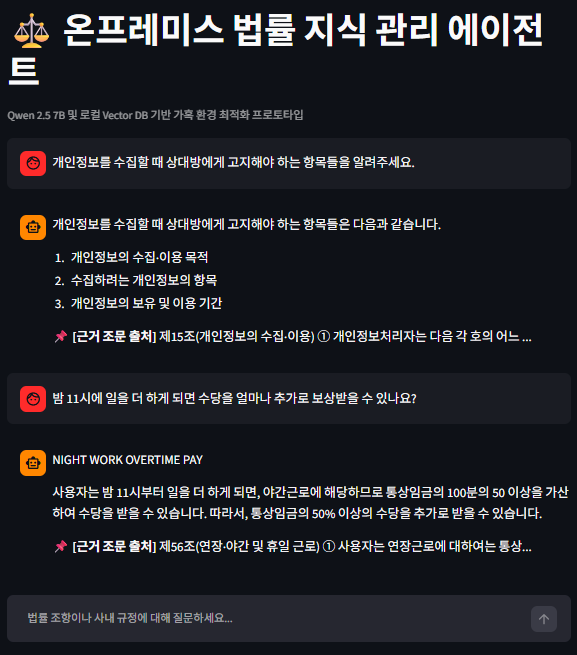

# Local Law RAG ⚖️

100% 온프레미스(오프라인) 환경에서 동작하는 **한국어 법률 질의응답 RAG(Retrieval-Augmented Generation) 챗봇** 프로토타입입니다.

외부 클라우드 API 없이, **16GB RAM + CPU 전용** 저사양 머신에서 다음 스택으로 구성되어 있습니다.

| 구성 요소 | 사용 기술 | 역할 |
|---|---|---|
| LLM 추론 | [Ollama](https://ollama.com) — `qwen2.5:7b` / `gemma2:9b` / `deepseek-r1:1.5b` | 한국어 법률 답변 생성 |
| 임베딩 | `jhgan/ko-sbert-nli` (sentence-transformers) | 법조문·질문의 한국어 벡터화 |
| 벡터 DB | [Chroma](https://www.trychroma.com) | 법조문 시맨틱 검색 |
| 오케스트레이션 | [LangChain](https://www.langchain.com) | 청킹/검색/프롬프트 파이프라인 |
| UI | [Streamlit](https://streamlit.io) | 채팅형 웹 인터페이스 |

## 📁 프로젝트 구조

```
local-rag-law/
├── app-local-qwen-law-rag.py        # Streamlit 챗봇 UI (Ollama 백엔드, Qwen2.5 7B)
├── app-local-qwen-law-rag-llamacpp.py  # Streamlit 챗봇 UI (llama-cpp-python 백엔드)
├── law_rag_core.py                  # 공용 RAG 코어 (배치 상관없이 재사용)
├── bench-rag-perf.py                # 속도/메모리 벤치마크 (Ollama 대 llama.cpp)
├── local-qwen-law-rag.ipynb         # Jupyter 실험 노트북 (Gemma2 9B)
├── local-gemma2-law-rag.ipynb       # Jupyter 실험 노트북 (Gemma2 9B)
├── local-qwen-law-rag.py            # 노트북의 .py 변환본
├── models/                          # GGUF (gitignore, Ollama 캐시에서 추출)
├── benchmarks/                      # 측정 원시 데이터 + 자동 리포트
├── screenshot.png                   # Streamlit 실행 예시 화면
└── 문서
    ├── README.md        # (이 문서)
    ├── ARCHITECTURE.md  # 시스템 아키텍처 상세
    ├── IMPLEMENTATION.md # 구현 상세
    ├── TROUBLES.md      # 트러블슈팅 기록
    ├── BENCHMARKS.md    # Ollama vs llama-cpp-python 측정 리포트
    ├── USAGE.md         # 앱별 실행 가이드
    ├── slides-benchmark.html  # 벤치마크 슬라이드 (HTML, 브라우저에서 ←/→ 탐색)
    └── BLOG_POST.md     # 소개용 블로그 글
```

## 🔍 시연 시나리오

내장된 샘플 법령 데이터(개인정보보호법·근로기준법 일부 조문)에 대해 다음과 같은 질문이 가능합니다.

- `개인정보를 수집할 때 상대방에게 고지해야 하는 항목들을 알려주세요.`
- `밤 11시에 일을 더 하게 되면 수당을 얼마나 추가로 보상받을 수 있나요?`

답변 하단에는 LLM이 참고한 **근거 조문 출처**가 함께 표시됩니다.

### 실행 화면



> ⚖️ Qwen 2.5 7B · 로컬 Vector DB 기반 가혹 환경 최적화 프로토타입 — 질문마다 검색된 근거 조문(제15조, 제56조)이 출처로 표시됩니다.

## 🚀 실행 방법

### 0. 사전 요구사항

1. **Ollama 설치** — <https://ollama.com/download>
2. **LLM 모델 다운로드** (택 1 이상)

```bash
ollama pull qwen2.5:7b    # Streamlit 앱 기본 모델
ollama pull gemma2:9b     # 노트북 기본 모델
ollama pull deepseek-r1:1.5b  # 초경량 (참고용)
```

3. Python 3.10+ 환경 권장

### 1. 의존성 설치

```bash
pip install streamlit \
    langchain langchain-community langchain-chroma langchain-huggingface langchain-ollama \
    sentence-transformers
```

### 2. Ollama 서버 실행

```bash
ollama serve   # 보통 설치 시 자동으로 백그라운드에서 이미 실행됨
```

### 3. 실행

```bash
# 채팅형 UI
streamlit run app-local-qwen-law-rag.py

# 노트북 실험 실행
jupyter lab local-qwen-law-rag.ipynb
```

> 첫 실행 시 `ko-sbert-nli` 임베딩 모델이 1회 다운로드되며, 이후 로컬 캐시를 사용합니다.

## 📚 문서

- **[ARCHITECTURE.md](ARCHITECTURE.md)** — 전체 파이프라인, 청킹 전략, 프롬프트 설계 근거
- **[IMPLEMENTATION.md](IMPLEMENTATION.md)** — 파일·셀별 구현 상세와 확장 가이드
- **[TROUBLES.md](TROUBLES.md)** — 개발 중 마주친 문제와 해결 기록

## ⚠️ 유의사항

- 본 프로젝트는 **연구/학습용 프로토타입**입니다. 답변은 법률 자문이 아니며, 실제 법률 판단의 근거로 사용해서는 안 됩니다.
- 샘플 법조문은 실제 조문을 요약/발췌한 형태이므로 최신 개정 여부를 반영하지 않을 수 있습니다.

## 🗺️ 로드맵

1. MarkdownHeaderTextSplitter 기반 대용량 법령 PDF 자동 인덱싱
2. NeMo Guardrails 등 프롬프트 인젝션 방어 레이어
3. 답변별 다중 근거 출처 표시(k=1 → Top-K 확장)
